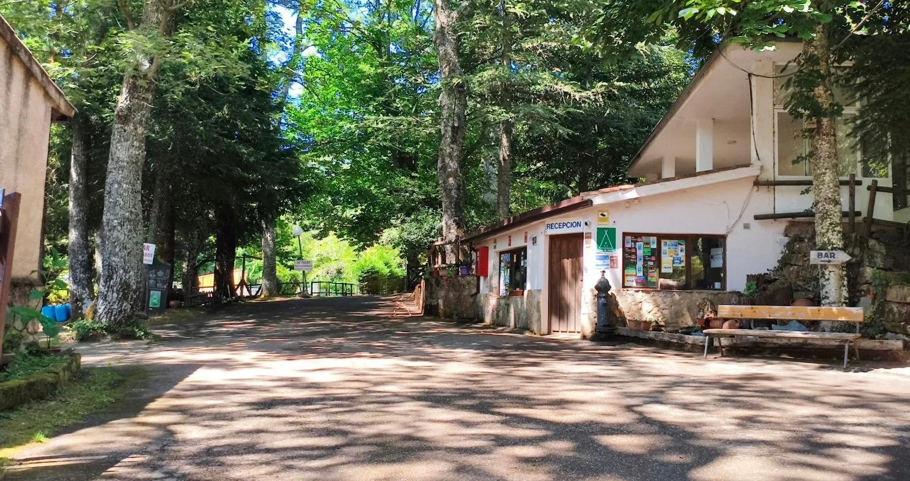
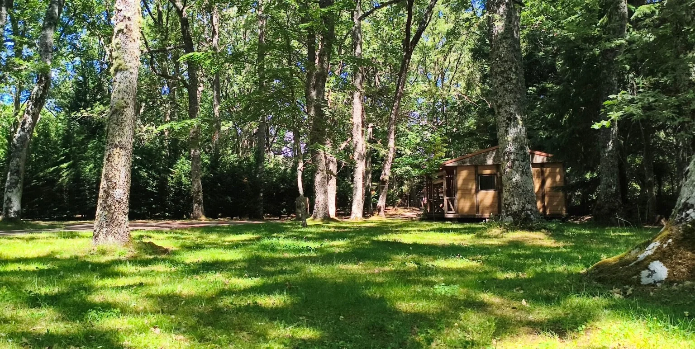
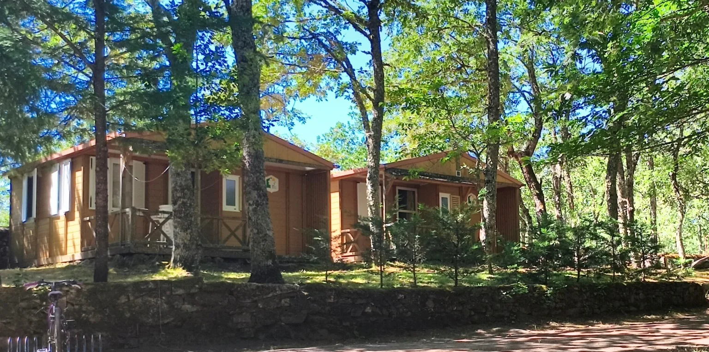
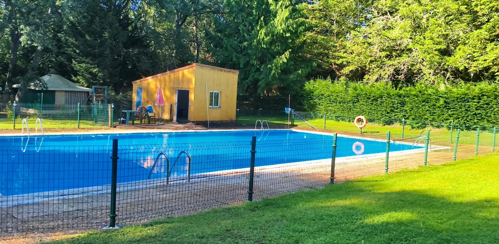
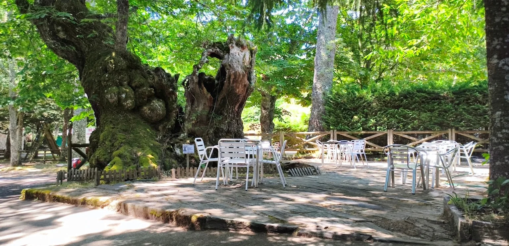

# Camping Sierra de Francia

<figure>
  
</figure>

  
## Un pequeño bosque dentro de un bosque.

A los pies de la [Peña de Francia](/la-sierra/pena-de-francia/), en El Casarito, a solo cuatro kilómetros de [La Alberca](/la-sierra/pueblos/la-alberca/), se encuentra nuestro pequeño camping familiar.

Desde 1977 recibimos a quienes vienen a conocer este rincón de Salamanca, pasar unos días al aire libre y explorar sus pueblos y paisajes.

Estamos dentro del **Parque Natural Las Batuecas–Sierra de Francia**, rodeados de robledales, montañas, caminos y pueblos llenos de historia.

Una forma sencilla de vivir la Sierra de Francia a tu ritmo.

**Bienvenidos a nuestro camping.**

[Conoce nuestro camping](/nuestro-camping/) · [Descubre nuestras parcelas](/nuestro-camping/parcelas/) · [Nuestros bungalows](/nuestro-camping/bungalows/) · [Contacto y reservas](/contacto/)

---

## Un camping con mucha sombra cerca de La Alberca

<figure>
  
</figure>

Nuestro camping es, sobre todo, un robledal.

Un pequeño bosque de aproximadamente **15.000 m²**, dominado por enormes robles, entre los que también crecen castaños —algunos centenarios— y otras especies de árboles.

Sus grandes copas proporcionan abundante sombra natural en prácticamente todo el recinto, con la excepción de la zona de la piscina.

En verano, cuando el calor aprieta, las copas de los árboles crean un ambiente especialmente agradable y marcan el carácter de nuestras parcelas.

Aquí la naturaleza no es un decorado. Forma parte de la estancia.

Los árboles estaban aquí mucho antes que nosotros y queremos que sigan siendo los protagonistas.

No somos un gran complejo turístico, ni queremos serlo. Preferimos mantener una escala humana y un trato personal y cercano.

Aquí los niños pueden jugar al aire libre y cada visitante encuentra su propia manera de pasar el día.

**[Descubre cómo es nuestro camping y sus instalaciones](/nuestro-camping/)**

---

## Alojarse en el Camping Sierra de Francia

<figure>
  
</figure>

Hay muchas formas de disfrutar de unos días en la Sierra de Francia.

Puedes dedicar la mañana a una excursión, visitar alguno de los pueblos de la comarca, disfrutar de la piscina o pasar el día en el camping.

Para algunos, las vacaciones son descanso. Para otros, descubrir lugares nuevos. Y para muchos, una combinación de ambas cosas.

Nuestro camping permite disfrutar de esas experiencias.

### Parcelas para disfrutar del camping tradicional

Nuestras parcelas permiten disfrutar de la acampada tradicional, con el propio equipamiento y en un recinto donde los árboles forman parte de la experiencia.

Una opción para quienes viajan con su propio equipamiento y quieren tener la Sierra de Francia como punto de partida.

**Admitimos mascotas en las parcelas y en la zona de acampada.** No se admiten mascotas en los bungalows.

**[Conoce las parcelas del camping](/nuestro-camping/parcelas/)**

### Bungalows en plena naturaleza

Para quienes prefieren la comodidad de un alojamiento de madera durante su estancia.

Disponemos de dos tipos de bungalows de madera, **Tomé y Roble**, con capacidad para cinco personas cada uno.

Una alternativa a las parcelas para descubrir la comarca desde El Casarito.

**[Descubre nuestros bungalows en la Sierra de Francia](/nuestro-camping/bungalows/)**

### Instalaciones y servicios

<figure>
  
</figure>

Nuestro camping dispone de servicios para hacer más cómoda la estancia:

- Piscina gratuita para nuestros clientes.
- Parque Infantil.
- Agua caliente gratis.
- Bar y terraza.
- Servicio de lavadora.
- Microtienda.
- Wi-Fi.

Son servicios pensados para acompañar la estancia sin transformar el carácter del lugar.

<figure>
  
</figure>

**[Consulta las instalaciones y servicios de nuestro camping](/nuestro-camping/#instalaciones-y-servicios)**

---

## La Sierra de Francia comienza aquí

Una de las cosas que hacen especial a nuestro camping es su ubicación.

Estamos en **El Casarito, en el municipio de Nava de Francia**, a las faldas de la Peña de Francia, uno de los grandes símbolos naturales y culturales de Salamanca.

Nos encontramos dentro del Parque Natural Las Batuecas–Sierra de Francia, un territorio de montañas, valles, robledales, castañares y paisajes que cambian con las estaciones.

Pero la riqueza de esta tierra no está solamente en sus bosques.

La Sierra de Francia conserva un extraordinario patrimonio histórico y cultural, con pueblos de arquitectura tradicional, calles empedradas, plazas, iglesias, castillos y costumbres que forman parte de su identidad.

Desde El Casarito puedes acercarte a ese patrimonio y organizar excursiones diferentes cada día.

**Un lugar para quedarse y toda una sierra por descubrir.**

[Conoce la Sierra de Francia](/la-sierra/) · [Descubre sus pueblos](/la-sierra/pueblos/) · [Explora sus rutas](/rutas/)

---

## La Alberca y otros cinco conjuntos históricos en la Sierra de Francia

Muy cerca del camping se encuentra **[La Alberca](/la-sierra/pueblos/la-alberca/)**, uno de los pueblos más conocidos de Salamanca y uno de los primeros conjuntos históricos declarados en España.

Pasear por sus calles permite descubrir una arquitectura tradicional muy característica y una historia estrechamente vinculada a la vida de estas montañas.

Pero La Alberca es solamente el comienzo.

La Sierra de Francia cuenta con **seis pueblos declarados conjuntos históricos**, cada uno con su propia personalidad.

### La Alberca

Calles empedradas, arquitectura tradicional, plazas y una historia estrechamente relacionada con la identidad de la Sierra de Francia.

**[Qué ver en La Alberca](/la-sierra/pueblos/la-alberca/)**

### Mogarraz

Un pueblo conocido por su arquitectura serrana y los retratos de antiguos vecinos que aparecen en las fachadas de sus casas.

**[Descubre Mogarraz](/la-sierra/pueblos/mogarraz/)**

### San Martín del Castañar

Una localidad con un importante patrimonio histórico, su castillo y un paisaje de bosques y montañas.

**[Conoce San Martín del Castañar](/la-sierra/pueblos/san-martin-del-castanar/)**

### Miranda del Castañar

Una villa amurallada de origen medieval, con un castillo y un conjunto urbano que conserva buena parte de su carácter histórico.

**[Qué visitar en Miranda del Castañar](/la-sierra/pueblos/miranda-del-castanar/)**

### Sequeros

Un pueblo de arquitectura tradicional, historia cultural y una posición privilegiada para contemplar los paisajes de la comarca.

**[Descubre Sequeros](/la-sierra/pueblos/sequeros/)**

### Villanueva del Conde

Una localidad con un singular trazado urbano y construcciones tradicionales que reflejan la historia de la vida serrana.

**[Conoce Villanueva del Conde](/la-sierra/pueblos/villanueva-del-conde/)**

Son pueblos para recorrer sin prisas, detenerse en sus plazas, observar los detalles de sus casas y descubrir las historias que conservan.

**[Explora nuestra guía de pueblos de la Sierra de Francia](/la-sierra/pueblos/)**

---

## Naturaleza: Peña de Francia y Las Batuecas

La Sierra de Francia ofrece paisajes muy diferentes en un territorio relativamente pequeño.

### Peña de Francia

La [Peña de Francia](/la-sierra/pena-de-francia/), con sus 1.723 metros de altitud, es uno de los grandes referentes paisajísticos de la comarca.

Su cumbre, su santuario y sus panorámicas la convierten en uno de los lugares más conocidos del entorno.

Desde El Casarito también existen caminos que permiten ascender a pie.

[Conoce la Peña de Francia](/la-sierra/pena-de-francia/) · [Subida desde El Casarito](/rutas/desde-el-camping/subida-pena-de-francia/)

### Valle de Las Batuecas

El [valle de Las Batuecas](/la-sierra/valle-de-las-batuecas/) ofrece un paisaje diferente, de barrancos, bosques, cursos de agua y un importante patrimonio natural e histórico.

Es uno de los espacios más singulares del Parque Natural Las Batuecas–Sierra de Francia.

**[Descubre el valle de Las Batuecas](/la-sierra/valle-de-las-batuecas/)**

---

## Rutas y senderismo desde nuestro camping

No siempre hace falta coger el coche para descubrir la Sierra de Francia.

Desde el propio camping y sus inmediaciones parten diferentes caminos y rutas de senderismo que permiten adentrarse en nuestros bosques y recorrer algunos de los paisajes más característicos del entorno.

Hay paseos tranquilos para disfrutar de la naturaleza y recorridos más largos para quienes quieren dedicar varias horas a caminar.

Los caminos atraviesan robledales, zonas de castaños y paisajes que muestran la riqueza natural de estas montañas. Caminar permite conocerlos de cerca y a otro ritmo.

### Senda de los Castaños Centenarios

Un paseo circular de aproximadamente 1,6 km entre grandes árboles, algunos con más de 500 años.

Una de las mejores propuestas para descubrir el entorno natural de El Casarito.

**[Recorre la Senda de los Castaños Centenarios](/rutas/desde-el-camping/castanos-centenarios/)**

### Camino del Peñasco

Una ruta corta por los bosques y formaciones rocosas del entorno.

Un recorrido para conocer rincones próximos al camping.

**[Descubre el Camino del Peñasco](/rutas/desde-el-camping/camino-del-penasco/)**

### Bosque Animado de Nava de Francia

Una propuesta familiar con figuras de animales y personajes integrados en el entorno natural.

**[Conoce el Bosque Animado de Nava de Francia](/rutas/desde-el-camping/bosque-animado/)**

### Subida a la Peña de Francia

Una excursión de montaña para quienes quieren disfrutar de una caminata más exigente.

**[Consulta la ruta de subida a la Peña de Francia](/rutas/desde-el-camping/subida-pena-de-francia/)**

También existen otros caminos tradicionales hacia Nava de Francia, La Alberca y localidades cercanas.

[Ver todas las rutas desde el camping](/rutas/desde-el-camping/) · [Otros caminos de El Casarito](/rutas/desde-el-camping/otras-rutas/)

---

## Caminos de Arte en la Naturaleza

La Sierra de Francia cuenta con cuatro recorridos que combinan senderismo, pueblos históricos y obras de arte contemporáneo integradas en el paisaje.

En ellos, las intervenciones artísticas invitan a mirar el territorio de otra manera.

### Camino de las Raíces

Un recorrido circular de aproximadamente 8 km por el entorno de La Alberca, entre bosques, ermitas e intervenciones artísticas.

**[Descubre el Camino de las Raíces](/rutas/caminos-de-arte-en-la-naturaleza/camino-de-las-raices/)**

### Camino del Agua

Una ruta circular de aproximadamente 6 km entre Mogarraz y Monforte de la Sierra, con arroyos, puentes, vegetación y arte.

**[Descubre el Camino del Agua](/rutas/caminos-de-arte-en-la-naturaleza/camino-del-agua/)**

### Bosque de los Espejos

Un recorrido circular de aproximadamente 9,2 km que conecta Sequeros, Las Casas del Conde y San Martín del Castañar.

**[Descubre el Bosque de los Espejos](/rutas/caminos-de-arte-en-la-naturaleza/bosque-de-los-espejos/)**

### Camino de los Prodigios

Una ruta circular de aproximadamente 10,2 km entre Miranda del Castañar y Villanueva del Conde, con arte, bosques y patrimonio.

**[Descubre el Camino de los Prodigios](/rutas/caminos-de-arte-en-la-naturaleza/camino-de-los-prodigios/)**

[Conoce los cuatro Caminos de Arte en la Naturaleza](/rutas/caminos-de-arte-en-la-naturaleza/)

También puedes explorar [otras rutas por la Sierra de Francia](/rutas/otras-rutas/) o consultar nuestra [guía general de senderismo](/rutas/).

---

## Mucho más por descubrir cerca de la Sierra de Francia

Nuestro camping también puede servir como punto de partida para conocer otros territorios del sur de Salamanca y del norte de Extremadura.

### Las Hurdes

Al sur de la Sierra de Francia se extiende la comarca de Las Hurdes, con montañas, valles profundos, pequeñas localidades y paisajes tan conocidos como el meandro del Melero.

**[Descubre Las Hurdes](/la-sierra/comarcas-cercanas/las-hurdes/)**

### Ciudad Rodrigo

Una ciudad histórica con murallas, patrimonio monumental y una larga historia relacionada con la frontera portuguesa.

**[Conoce Ciudad Rodrigo](/la-sierra/comarcas-cercanas/ciudad-rodrigo/)**

### Béjar y Candelario

Otra zona de montaña del sur de Salamanca, con patrimonio histórico, arquitectura tradicional y paisajes diferentes a los de la Sierra de Francia.

**[Descubre Béjar y Candelario](/la-sierra/comarcas-cercanas/bejar-y-candelario/)**

[Explora todas nuestras propuestas de comarcas cercanas](/la-sierra/comarcas-cercanas/)

---

## Tu guía turístico: descubre la Sierra de Francia a tu manera

Conocer bien un territorio lleva tiempo.

Nosotros vivimos aquí y nos gusta compartir lo que sabemos de nuestra tierra.

Si vienes a pasar unos días, queremos ayudarte a aprovecharlos: descubrir pueblos, encontrar caminos, visitar lugares especiales y conocer rincones que quizá no habías pensado visitar.

Por eso estamos desarrollando una guía para organizar tu estancia según **los días que vayas a pasar en el camping y tus intereses**.

Mientras completamos esa sección, ya puedes encontrar propuestas provisionales para:

- Visitar la Sierra de Francia en un día.
- Organizar una escapada de dos o tres días.
- Descubrir la comarca durante una estancia de cinco días.
- Elegir excursiones de naturaleza y senderismo.
- Conocer pueblos y patrimonio.
- Preparar actividades para disfrutar en familia.

No queremos ofrecerte una lista interminable de lugares que visitar deprisa.

Queremos ayudarte a elegir aquello que más te interese y disfrutarlo a tu ritmo.

**[Organiza tu estancia con nuestra guía turística](/tu-guia/)**

---

## Un camping familiar desde 1977

Nuestra historia comenzó en 1977.

Desde entonces, el Camping Sierra de Francia ha recibido a generaciones de visitantes que han venido a disfrutar de este pequeño rincón de El Casarito.

Han cambiado muchas cosas a lo largo de estos años. Los árboles han seguido creciendo y nosotros hemos aprendido de las personas que nos visitan y de la tierra que nos rodea.

Pero hay algo que queremos conservar: nuestra manera de entender el camping.

Nos gusta conversar con nuestros visitantes, recomendarles lugares que conocemos y compartir con ellos nuestro cariño por esta tierra.

No pretendemos ser algo diferente de lo que somos.

**Un pequeño camping familiar, en un lugar extraordinario.**

[Conoce nuestra historia y nuestro camping](/nuestro-camping/)

---

## Cuándo abrimos

Nuestro camping tiene una apertura estacional.

Habitualmente abrimos durante **Semana Santa, el puente de mayo y la temporada de verano, del 1 de julio al 31 de agosto**.

Las fechas concretas pueden variar de un año a otro, por lo que recomendamos consultar la apertura y la disponibilidad antes de organizar la estancia.

**[Consulta las fechas de apertura y contacta con nosotros](/contacto/)**

---

## Contacto y reservas

Si estás preparando una estancia en la Sierra de Francia, estaremos encantados de ayudarte a organizarla. Puedes venir a caminar, conocer sus pueblos, disfrutar de unos días en familia o, sencillamente, no hacer demasiados planes.

Estamos en **El Casarito, 37659 Nava de Francia, Salamanca**, a los pies de la Peña de Francia.

Puedes contactar directamente con nosotros para consultar disponibilidad de parcelas o bungalows.

**WhatsApp y teléfono:** [661 535 704](tel:+34661535704)

**Correo electrónico:** [campingsierradefrancia@gmail.com](mailto:campingsierradefrancia@gmail.com)

[**Escríbenos por WhatsApp**](https://wa.me/34661535704)

[**Información de contacto, ubicación y reservas**](/contacto/)

---

**Camping Sierra de Francia**

*Un pequeño bosque dentro de un bosque.*

El Casarito · Nava de Francia · Salamanca
